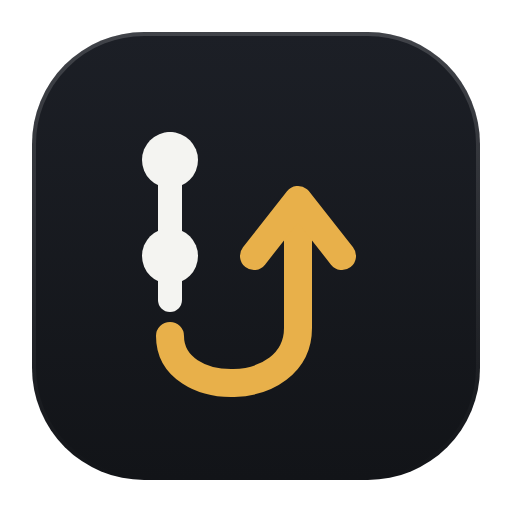
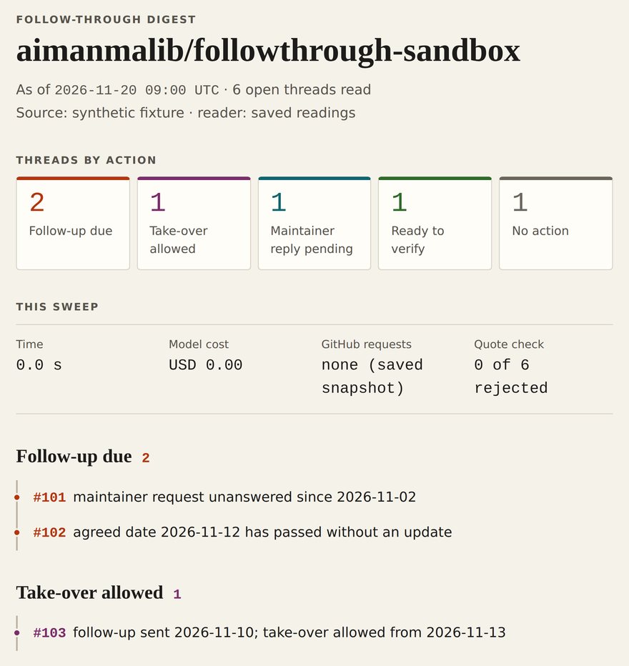
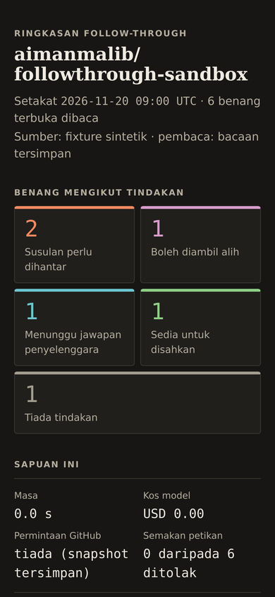
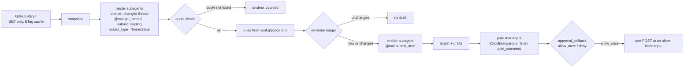

<p align="center"></p>

<h1 align="center">Follow-Through</h1>

<p align="center"><a href="https://github.com/aimanmalib/followthrough/actions/workflows/ci.yml"></a> <a href="https://github.com/aimanmalib/followthrough/releases/latest"></a> <a href="https://github.com/aimanmalib/followthrough/blob/main/LICENSE"></a> <a href="https://pypi.org/project/openminion/0.1.23/"></a></p>

<p align="center"><b>Your CONTRIBUTING follow-up rules, applied every day, with a human approving every comment.</b> · <i>Peraturan susulan CONTRIBUTING anda, dijalankan setiap hari, dengan manusia meluluskan setiap komen.</i><br>
<a href="https://aimanmalib.github.io/followthrough/">live demo page</a> · <a href="#try-it-without-a-key-one-command">one-command demo</a> · <a href="#run-it-on-your-own-repository-two-steps">run on your repo</a> · <a href="#how-follow-through-uses-the-openminion-sdk">how it uses OpenMinion</a> · <a href="#documentation">documentation</a> · <a href="CHANGELOG.md">changelog</a> · <a href="README.ms.md">Bahasa Melayu</a> · Built in Malaysia by Aiman Malib</p>

<p align="center"></p>

Follow-Through applies a repository's own CONTRIBUTING follow-up rules every day: it reads each changed
issue thread, works out who is waiting on whom, drafts the follow-up a maintainer would write, waits for a
human to approve it, and never sends the same reminder twice.

Busy repositories write these rules down and then track them by hand. The OpenMinion repository opened
188 issues and 318 pull requests in the 31 days to 17 November 2026, and had 107 open items on 18 November.
Its CONTRIBUTING guide says to follow up after 7 calendar days without a reply, to ask for an update when
an agreed date slips, to allow 3 calendar days after a follow-up before taking work over, and to keep fixed
issues open with `status:awaiting-release` until the fix is checked in a release. Follow-Through turns those
sentences into dated actions, and every date it shows can be traced back to a real comment.

> **Unofficial.** Not affiliated with, endorsed by, or supported by the OpenMinion or Cortensor teams. It reads
> public GitHub data with GET requests only and posts nowhere except an allow-listed repository, after a human says yes.

Built for **Cortensor Hackathon #5** (November to December 2026) as an agent on the OpenMinion SDK.

[Bahasa Melayu: README.ms.md](README.ms.md)

| Digest, desktop, English | Digest, iPhone, Malay, dark |
| --- | --- |
|  |  |

## Features

- **Who is waiting on whom.** One OpenMinion subagent per changed thread returns a typed thread state:
  waiting on the maintainer, the contributor, a release, nobody, or unclear.
- **Quotes that must exist.** Every date the model relies on comes with a quote. The quote must appear word for
  word in one real comment, and the date must be that comment's own time. Otherwise the reading is rejected,
  the thread is marked unclear, and the rejection is counted.
- **Rules, not guesses.** Five actions (follow-up due, take-over allowed, maintainer reply pending, ready to verify,
  no action) come from deterministic rules with a clock you can set (`--now`). Windows, labels, models, prices
  and limits live in `config/*.toml`, not in the code.
- **Drafts a maintainer would write.** Up to 120 words, citing the CONTRIBUTING step, with every computed date in
  the text and no @mentions. A draft that fails these checks is not saved.
- **One write path.** `post_comment` checks a stop file first, then the allow-list, then asks a human
  (`allow_once` or `deny`). No answer means no post. The shipped allow-list holds only the project's own sandbox.
- **No repeated reminders.** A ledger keyed on each thread's state (update time, comment count, labels) holds back a
  second draft until something changes or the entry expires.
- **Spend limits.** USD 1.00 per sweep and USD 20.00 in total (`config/budget.toml`); a sweep that would cross
  either stops with a message.
- **English and Malay.** The command line, the digest and its HTML page take `--lang en|ms`; all strings are in
  `locales/`.

## Try it without a key: one command

To look first, the [demo page](https://aimanmalib.github.io/followthrough/) shows the digest for the synthetic
sample repository ([in Malay](https://aimanmalib.github.io/followthrough/ms/)), rebuilt from `main` on every push.
To run it yourself:

```sh
demo/run.sh
```

Needs Docker only. It builds a small image and runs the real pipeline on the synthetic sample repository: one reader
subagent per thread, the quote check, the rules and the drafter. It prints the digest and the saved drafts.
Every model answer is replayed from `fixtures/recorded/`, recorded once from the real API with
`followthrough replay --record`. The container has no network and no key, and the image is removed afterwards.
A request that was never recorded fails the run with a diff instead of reaching the API. The demo guide
[`demo/README.md`](demo/README.md) walks from sweep to digest to draft to approval, with what to look at in each step.

Without Docker, the same sample runs on saved readings with no model at all:

```sh
uv sync
uv run followthrough sweep --fixture --lang en
uv run followthrough sweep --fixture --lang ms
```

Each sweep also writes `digest.md`, `digest.json`, `metrics.json` and a self-contained `digest.html` (the page in the
screenshots) to `out/<date>/`.

## Run it on your own repository: two steps

1. Install and set the keys. Python 3.12 and [uv](https://docs.astral.sh/uv/):

   ```sh
   git clone https://github.com/aimanmalib/followthrough && cd followthrough
   uv sync
   export ANTHROPIC_API_KEY=...            # the model key
   export GITHUB_TOKEN=$(gh auth token)    # read access is enough
   ```

2. Sweep, read the digest, review the drafts:

   ```sh
   uv run followthrough sweep --live --repo owner/name --draft
   uv run followthrough post --repo owner/name --number 42 --draft out/<date>/drafts/42.md
   ```

`post` shows the draft and asks `allow_once` or `deny`; it posts the file's text exactly. It refuses any repository that is not in `config/safety.toml` `allow_post_repos`; add your own repository
there first. Edit `config/policy.toml` for your own follow-up windows and status labels.

Follow-Through does not install a scheduler. `followthrough schedule --daily 06:30 --repo owner/name` proves an
OpenMinion cron task in a throw-away home (one run, then paused and deleted, no daemon left) and prints a line for
your own crontab:

```
30 6 * * * cd /path/to/followthrough && uv run followthrough sweep --live --repo owner/name --draft >> out/cron.log 2>&1
```

`followthrough doctor` checks the OpenMinion setup. Each sweep writes per-turn telemetry
(`out/<date>/telemetry.json`: tokens, cost, run stats; no thread text).

## How Follow-Through uses the OpenMinion SDK



- **Agents and subagents.** `src/followthrough/agents.py` builds a reader `Agent` and calls `subagent()` once per
  changed thread, each with its own session and `output_type=ThreadState` (Pydantic). Workers run in parallel,
  one OpenMinion runtime each. Model profiles (`reader`, `drafter`) are written to `agents.json` from
  `config/models.toml`.
- **Tools.** `get_thread` (`@tool(min_scope="READ_ONLY", idempotent=True)`) reads the saved snapshot, never the
  network. `submit_reading` and `submit_draft` carry the output schema as typed tool arguments.
- **Approval.** `src/followthrough/post.py` defines `post_comment` with `@tool(dangerous=True, min_scope="WRITE_SAFE")`
  and runs the publisher with `approval_callback`. The callback sees the exact body; the tool refuses a body that
  differs from the approved one.
- **Diagnostics, telemetry, scheduling.** `openminion doctor --check-turn --json`, per-turn run stats, and
  `openminion cron create / run / pause` for the schedule proof.
- **Provider endpoint.** The built-in `anthropic` provider's `base_url` points at the local replay server for the
  key-free demo.

What worked, what broke and the evidence for each block: [`BUILDING_BLOCKS.md`](BUILDING_BLOCKS.md).
Feedback for the OpenMinion team: [`LEARNED.md`](LEARNED.md).

## The problem, in the numbers

Counted with read-only GitHub searches on 18 November 2026 (details in [`docs/TEST-RESULTS.md`](docs/TEST-RESULTS.md),
"Upstream activity"): 188 issues and 318 pull requests opened in `openminion/openminion` between 18 October and
17 November 2026; 107 open issues and pull requests; 18 open issues labelled `status:awaiting-release`. Each of these
has a CONTRIBUTING rule with a date attached, and nobody is paid to compute those dates.

## What already exists

Stale bots, such as GitHub's own `actions/stale`, count days since the last activity, add a label and close the
thread. They do not know who owes the next answer, they cannot tell a maintainer's promise from a contributor's,
and they act without asking. Follow-Through does not close or label anything. It reads who is waiting on whom,
quotes the comment that proves it, and leaves the decision and the comment to a person.

## Hackathon requirements

| Requirement | Where |
| --- | --- |
| Public source repository and README with setup and run instructions | this README; [Run it on your own repository](#run-it-on-your-own-repository-two-steps) |
| Short explanation of the OpenMinion SDK workflow | [How Follow-Through uses the OpenMinion SDK](#how-follow-through-uses-the-openminion-sdk) |
| One working example | [`demo/run.sh`](demo/run.sh) (no key) and `followthrough sweep --live` |
| Building Blocks Tested note | [`BUILDING_BLOCKS.md`](BUILDING_BLOCKS.md), 11 blocks |
| What We Learned note | [`LEARNED.md`](LEARNED.md) |
| Bugs with reproduction steps, expected and actual results, safe evidence | [`repro/`](repro/README.md), 3 key-free scripts that talk only to 127.0.0.1 |
| 1 to 5 minute demo video | not published yet (see [Limits](#limits-and-honest-notes)) |

## Tests and measured results

All numbers below are copied from [`docs/TEST-RESULTS.md`](docs/TEST-RESULTS.md), which also lists every failure.

- **Offline suite:** 282 tests passed in public CI (GitHub Actions run 44279632622, 18 November 2026), with no key and
  no network. CI also runs the fixture sweep in both languages and the key-free Docker demo.
- **Approval gate (H4):** in the sandbox demo, `deny` posted nothing, `allow_once` posted exactly 1 comment
  (byte-identical to the saved draft), and a stop file ended the run with exit code 5 before any request.
- **Reminder ledger (H3):** a second sweep with nothing changed makes 0 drafts; one changed thread makes exactly 1.
- **Read-only live sweep (H1) on `openminion/openminion`:** every GitHub request was `GET` (225 per snapshot in
  runs 1 to 4, 347 in the final run), 0 writes; every run stayed under USD 1.00. No run read every open
  thread; the final run ended in 18 min 21 s with 32 of 134 read (see Limits).
- **Quote check (H6):** on fresh live readings it rejected 22 of 41 (0.54), almost all because the model gave a
  follow-up time that matches no maintainer post.
- **Label agreement (H2):** 0.171 and 0.204 after the quote check (0.293 and 0.347 as read) in the two test runs, against
  a target of 0.80.
- **Key-free replay (H5):** 83 recorded model exchanges answered, 0 missed, digest and drafts byte-identical; the cold CI
  runner finished the replay 32 s after the step started.
- **Digest page (R4):** 24 of 24 checks passed in Chromium and WebKit (iPhone 13), at 320 px and desktop width, light and
  dark: no horizontal overflow, no console errors, WCAG AA contrast.

### Tested with

openminion 0.1.23 (pinned), Python 3.12, uv, `claude-haiku-5-5` as the reader and `claude-sonnet-5-5` as the drafter,
Docker for the demo, Playwright Chromium and WebKit for the page checks.

## Limits and honest notes

- **H1 is not met.** On a shared, heavily loaded host no live sweep read every open OpenMinion thread in 20 minutes:
  the final run read 32 of 134 before its time limit. Reader turns of 90 to 240 s were common.
- **H2 is not met.** Agreement with the repository's status labels is 0.171 and 0.204 after the quote check (two test runs). The largest gap: issues
  labelled `status:maintainer-investigation` whose newest open request is a maintainer's question to the reporter.
- **The quote check rejects about half of fresh live readings.** That is the guard doing its job, but it means many
  threads end up unclear.
- **The three OpenMinion findings are drafted, not filed.** No upstream issue or fix pull request exists yet.
- **The demo video is not published yet**, and this repository is private until the entry is ready.
- **Cortensor's own inference network is not used.** The agent calls Anthropic models through OpenMinion's built-in
  provider; the optional Cortensor Portal path needs access this project does not have.
- **The sandbox demo uses one account** for every seeded post, and the rules' clock is moved with `--now` instead of
  waiting 8 days.
- **OpenMinion is pinned to 0.1.23.** The SDK releases every few days; findings are stated for that version.

## How AI is used

At run time the agent sends thread text to an Anthropic model through OpenMinion to read who is waiting on whom, and
again to write a draft. The model's answer is never trusted on its own: dates must be backed by quotes that exist in the
thread, the actions come from rules, and a person approves every comment.

## AI disclosure

This project is an entry to Cortensor Hackathon #5. The code and documentation are written with Claude Code (Anthropic),
directed and reviewed by the author. The narration in the demo video uses an ElevenLabs clone of the author's own voice.
The agent itself calls Anthropic models through OpenMinion at run time, within the spend limits in `config/budget.toml`.

## Documentation

| Document | What is in it |
| --- | --- |
| [`docs/TEST-RESULTS.md`](docs/TEST-RESULTS.md) | every measured number, with the failures |
| [`docs/decisions/`](docs/decisions/) | design decisions, each with a rollback note |
| [`BUILDING_BLOCKS.md`](BUILDING_BLOCKS.md) | OpenMinion blocks used: where, what worked, what broke, evidence |
| [`LEARNED.md`](LEARNED.md) | feedback for the OpenMinion team |
| [`repro/`](repro/README.md) | key-free reproduction scripts for the findings |
| [`STATUS.md`](STATUS.md) | what is done and what is not |
| [`CONTRIBUTING.md`](CONTRIBUTING.md) | set-up, tests and rules for changes |
| [`demo/README.md`](demo/README.md) | demo guide: sweep, digest, draft, approval |
| [`RELEASE.md`](RELEASE.md) | release notes |
| [`CHANGELOG.md`](CHANGELOG.md) | changes by version |
| [`SECURITY.md`](SECURITY.md) | how to report a vulnerability |

## License

MIT. See [`LICENSE`](LICENSE).
