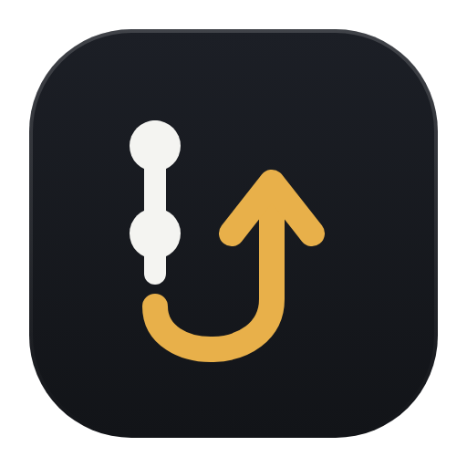
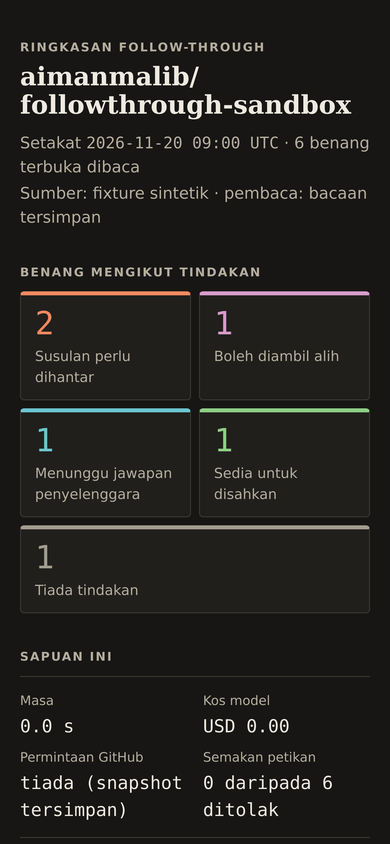

<p align="center"></p>

<h1 align="center">Follow-Through</h1>

<p align="center"><a href="https://github.com/aimanmalib/followthrough/actions/workflows/ci.yml"></a> <a href="https://github.com/aimanmalib/followthrough/releases/latest"></a> <a href="https://github.com/aimanmalib/followthrough/blob/main/LICENSE"></a> <a href="https://pypi.org/project/openminion/0.1.23/"></a></p>

<p align="center"><b>Your CONTRIBUTING follow-up rules, applied every day, with a human approving every comment.</b> · <i>Peraturan susulan CONTRIBUTING anda, dijalankan setiap hari, dengan manusia meluluskan setiap komen.</i><br>
<a href="#cuba-tanpa-kunci-satu-arahan">demo satu arahan</a> · <a href="#jalankan-pada-repositori-anda-dua-langkah">jalankan pada repo anda</a> · <a href="#cara-follow-through-memakai-openminion-sdk">cara ia memakai OpenMinion</a> · <a href="README.md">English</a> · <a href="CHANGELOG.md">changelog</a> · Dibina di Malaysia oleh Aiman Malib</p>

<p align="center"></p>

Follow-Through menjalankan peraturan susulan dalam CONTRIBUTING sesebuah repositori setiap hari: ia membaca setiap
benang isu yang berubah, menentukan siapa menunggu siapa, mendraf susulan yang akan ditulis oleh penyelenggara,
menunggu manusia meluluskannya, dan tidak pernah menghantar peringatan yang sama dua kali.

Repositori yang sibuk menulis peraturan ini, kemudian menjejaknya dengan tangan. Repositori OpenMinion menerima
188 isu dan 318 pull request dalam 31 hari hingga 17 November 2026, dan mempunyai 107 item terbuka pada 18 November.
CONTRIBUTING-nya menetapkan susulan selepas 7 hari kalendar tanpa jawapan, meminta kemas kini bila tarikh yang
dipersetujui terlepas, memberi 3 hari kalendar selepas susulan sebelum kerja diambil alih, dan mengekalkan isu yang
dibaiki terbuka dengan `status:awaiting-release` sehingga pembaikan disahkan dalam keluaran. Follow-Through menukar
ayat-ayat itu menjadi tindakan bertarikh, dan setiap tarikh yang dipaparkan boleh dijejak kepada komen sebenar.

> **Tidak rasmi.** Tiada kaitan dengan, sokongan atau pengesahan daripada pasukan OpenMinion atau Cortensor. Ia membaca
> data GitHub awam dengan permintaan GET sahaja dan tidak mengepos ke mana-mana kecuali repositori dalam senarai benar,
> selepas manusia bersetuju.

Dibina untuk **Cortensor Hackathon #5** (November hingga Disember 2026) sebagai ejen atas OpenMinion SDK.

## Ciri

- **Siapa menunggu siapa.** Satu subagen OpenMinion bagi setiap benang yang berubah memulangkan keadaan benang
  bertaip: menunggu penyelenggara, penyumbang, keluaran, tiada sesiapa, atau tidak jelas.
- **Petikan mesti wujud.** Setiap tarikh yang dipakai model datang bersama petikan yang mesti wujud kata demi kata
  dalam satu komen sebenar, dan tarikh itu mesti masa komen tersebut. Jika tidak, bacaan ditolak, benang ditanda
  tidak jelas, dan penolakan dikira.
- **Peraturan, bukan tekaan.** Lima tindakan datang daripada peraturan berketentuan dengan jam yang boleh ditetapkan
  (`--now`). Tetingkap, label, model, harga dan had berada dalam `config/*.toml`, bukan dalam kod.
- **Draf seperti tulisan penyelenggara.** Paling banyak 120 patah perkataan, memetik langkah CONTRIBUTING, dengan setiap
  tarikh yang dikira dan tanpa @sebutan.
- **Satu laluan tulis.** `post_comment` menyemak fail henti, kemudian senarai benar, kemudian bertanya manusia
  (`allow_once` atau `deny`). Tiada jawapan bermakna tiada pos.
- **Tiada peringatan berulang.** Lejar menahan draf kedua sehingga benang berubah.
- **Had belanja.** USD 1.00 setiap sapuan dan USD 20.00 keseluruhan (`config/budget.toml`).
- **Bahasa Inggeris dan Melayu.** Baris arahan, ringkasan dan halaman HTML-nya menerima `--lang en|ms`.

## Cuba tanpa kunci: satu arahan

```sh
demo/run.sh
```

Hanya perlukan Docker. Ia membina imej kecil dan menjalankan saluran sebenar atas repositori sampel sintetik, dengan
setiap jawapan model dimainkan semula dari `fixtures/recorded/`. Bekas itu tiada rangkaian dan tiada kunci; imej
dibuang selepas itu. Permintaan yang tidak pernah dirakam menggagalkan larian dengan beza, bukan menghubungi API.

Tanpa Docker, sampel yang sama berjalan atas bacaan tersimpan tanpa model:

```sh
uv sync
uv run followthrough sweep --fixture --lang ms
```

## Jalankan pada repositori anda: dua langkah

1. Pasang dan tetapkan kunci (Python 3.12 dan [uv](https://docs.astral.sh/uv/)):

   ```sh
   git clone https://github.com/aimanmalib/followthrough && cd followthrough
   uv sync
   export ANTHROPIC_API_KEY=...
   export GITHUB_TOKEN=$(gh auth token)
   ```

2. Sapu, baca ringkasan, semak draf:

   ```sh
   uv run followthrough sweep --live --repo owner/name --draft --lang ms
   uv run followthrough post --repo owner/name --number 42 --draft out/<tarikh>/drafts/42.md
   ```

`post` memaparkan draf dan bertanya `allow_once` atau `deny`. Ia menolak repositori yang tiada dalam
`config/safety.toml` `allow_post_repos`; tambah repositori anda di situ dahulu.

## Cara Follow-Through memakai OpenMinion SDK

Ejen pembaca (`Agent`) memanggil `subagent()` sekali bagi setiap benang yang berubah, dengan `output_type=ThreadState`
(Pydantic). Alat `get_thread` (`@tool(min_scope="READ_ONLY", idempotent=True)`) membaca snapshot tersimpan, bukan
rangkaian. Draf ditulis oleh subagen pendraf. `post_comment` ditanda `@tool(dangerous=True, min_scope="WRITE_SAFE")`
dan dijalankan dengan `approval_callback`. Rajah alir penuh ada dalam [README Inggeris](README.md#how-follow-through-uses-the-openminion-sdk);
apa yang berfungsi dan apa yang patah ada dalam [`BUILDING_BLOCKS.md`](BUILDING_BLOCKS.md).

## Ujian dan hasil yang diukur

Semua angka dari [`docs/TEST-RESULTS.md`](docs/TEST-RESULTS.md):

- 282 ujian luar talian lulus dalam CI awam, tanpa kunci dan tanpa rangkaian.
- Kotak pasir: `deny` tidak mengepos apa-apa, `allow_once` mengepos tepat 1 komen, fail henti menamatkan larian dengan kod keluar 5.
- Sapuan kedua tanpa perubahan menghasilkan 0 draf; satu benang berubah menghasilkan tepat 1.
- Sapuan hidup `openminion/openminion`: 225 daripada 225 permintaan GitHub ialah `GET`, 0 tulis, setiap larian di bawah USD 1.00.
- Persetujuan label: 0.171 selepas semakan petikan (sasaran 0.80, tidak dicapai).
- Main semula tanpa kunci: 83 pertukaran dijawab, 0 terlepas.

## Had dan nota jujur

- Sapuan hidup 108 benang OpenMinion tidak siap dalam 20 minit pada hos binaan, dan tiada larian membaca semua benang.
- Persetujuan dengan label status ialah 0.171, jauh di bawah sasaran 0.80.
- Semakan petikan menolak kira-kira separuh bacaan hidup yang segar.
- Tiga dapatan OpenMinion masih draf; tiada isu atau pull request pembaikan di huluan lagi.
- Video demo belum diterbitkan.
- Rangkaian inferens Cortensor tidak dipakai; ejen memanggil model Anthropic melalui penyedia terbina OpenMinion.
- OpenMinion dipin pada 0.1.23.

## Pengisytiharan AI

Projek ini ialah penyertaan Cortensor Hackathon #5. Kod dan dokumentasi ditulis dengan Claude Code (Anthropic), diarah
dan disemak oleh pengarang. Narasi dalam video demo memakai klon suara ElevenLabs pengarang sendiri. Ejen memanggil model
Anthropic melalui OpenMinion semasa berjalan, dalam had belanja `config/budget.toml`.

## Lesen

MIT. Lihat [`LICENSE`](LICENSE).
